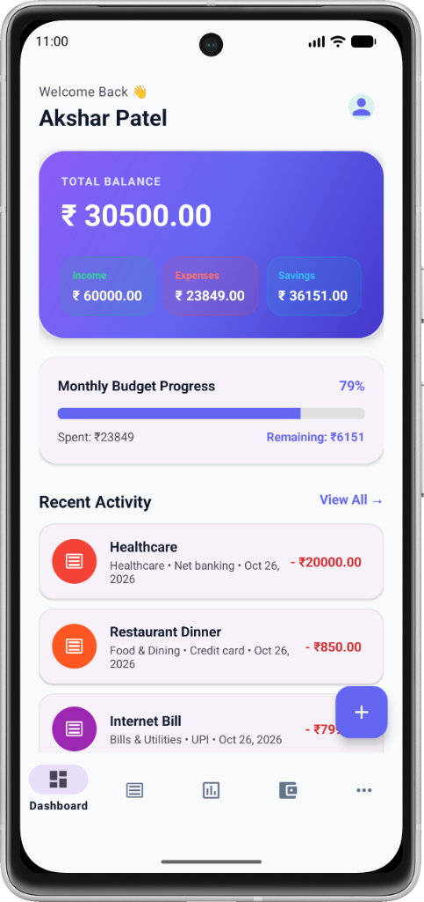
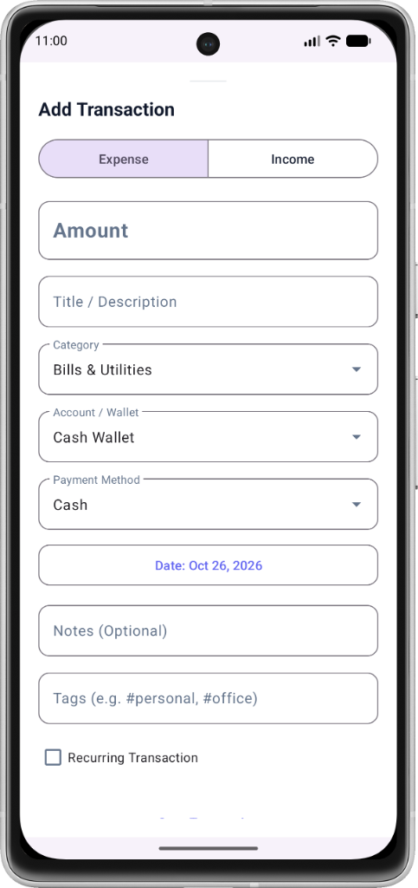
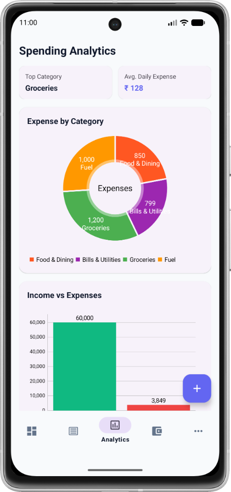
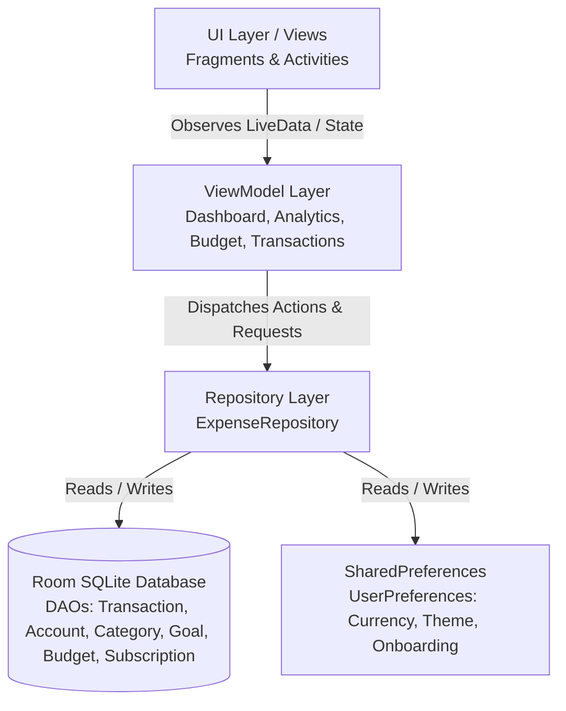

# 💰 FinTrack — Personal Finance & Expense Manager

<p align="center">
  
  
  
  
  
  
  
  
</p>

<p align="center">
  <strong>Take absolute control of your financial destiny.</strong><br>
  A modern, offline-first Android expense tracker built with <strong>Kotlin</strong>, <strong>Material Design 3</strong>, <strong>Room Database</strong>, and <strong>Clean MVVM Architecture</strong>. Effortlessly track daily spending, analyze income vs. expenses, manage multi-account balances, hit ambitious savings goals, and monitor recurring subscriptions.
</p>

---

## 📑 Table of Contents

- [✨ Key Features](#-key-features)
- [📱 Screen Previews](#-screen-previews)
- [🏗️ System Architecture](#-system-architecture)
- [🛠️ Tech Stack & Dependencies](#-tech-stack--dependencies)
- [📂 Project Directory Structure](#-project-directory-structure)
- [🗄️ Database Schema](#-database-schema)
- [🚀 Getting Started](#-getting-started)
  - [Prerequisites](#prerequisites)
  - [Build and Run](#build-and-run)
- [💡 Usage Highlights](#-usage-highlights)
- [🤝 Contributing](#-contributing)
- [📄 License](#-license)
- [👤 Author](#-author)

---

## ✨ Key Features

### 📊 1. Intuitive Financial Dashboard
- **Real-Time Net Worth Overview**: Instant calculation of total wealth aggregated across all linked accounts.
- **Dynamic Cash Flow**: Live visual breakdown of total income vs. total expenditures.
- **Recent Transactions Feed**: Fast chronological overview of latest financial actions with quick-edit access.
- **Personalized Profile**: Customizable user profile name and profile avatar image selection directly from your gallery.

### 💸 2. Flexible Transaction Management
- **Quick Logging**: Seamless bottom sheet dialog for recording transactions with minimum friction.
- **Dual Flow**: Categorize inputs as **Income** (Salary, Freelance, Investments) or **Expense** (Food, Fuel, Bills, Rent, etc.).
- **Multi-Account Attribution**: Associate every transaction with a specific payment account or wallet (Cash, HDFC Bank, Credit Card, Digital Wallet).
- **Automated Ledger Reconciliation**: Balances update automatically on insert, edit, or delete operations.
- **Search & Multi-Criterion Filtering**: Filter by transaction type (`All`, `Income`, `Expense`), sort dynamically by *Date (Newest/Oldest)* or *Amount (Highest/Lowest)*, and search by keywords in real time.

### 📈 3. Visual Analytics & Spending Insights
- **Category Expense Breakdown**: Interactive **MPAndroidChart Pie Chart** displaying percentage and absolute spending per category.
- **Drill-Down Detail**: Tap on any chart slice or category to open an itemized transactions list bottom sheet for granular analysis.
- **Weekly Trend Bar Chart**: 7-day spending distribution to detect expenditure surges and spending habits.
- **Financial Intelligence**: Automated calculation of your **Top Spending Category** and **Average Daily Burn Rate**.

### 🎯 4. Budget Planning & Overspending Alerts
- **Monthly Spending Cap**: Set a global monthly target budget with an interactive linear progress bar.
- **Category-Wise Budgets**: Allocate dedicated budget thresholds for individual categories (e.g., Dining, Groceries, Shopping).
- **Visual Alert Indicators**: Color-coded progress metrics (Normal $\rightarrow$ Approaching Limit $\rightarrow$ Overbudget) to keep spending in check.

### 🏦 5. Multi-Account & Wallet Management
- Support for diverse account types: **Cash Wallets**, **Bank Accounts**, **Credit Cards** (with negative liability balances), and **Digital Wallets**.
- Live balance adjustments with initial balance history retention.
- Add, update, and manage accounts independently.

### 🏆 6. Financial Savings Goals
- Establish financial milestones (e.g., *Emergency Fund*, *New Laptop*, *Vacation*).
- Define target amounts and goal completion dates.
- Interactive **"Add Funds"** dialog to log incremental savings with live percentage progress tracking.

### 🔁 7. Recurring Subscriptions & Fixed Bills
- Manage regular commitments: Streaming services, gym memberships, software licenses, rent, and utility bills.
- Configure recurring frequencies (Monthly, Yearly, Weekly) and track upcoming billing renewal dates.
- Keep tabs on monthly committed overheads before spending discretionary income.

### ⚙️ 8. Personalization, Dark Mode & Data Portability
- **Multi-Currency Support**: Switch between **Indian Rupee (₹)**, **US Dollar ($)**, **Euro (€)**, and **British Pound (£)** with global updates across all screens.
- **Sleek Dark Theme**: God-Level dark palette built for battery efficiency on OLED screens and comfort during night usage.
- **CSV Data Export**: Export entire transaction ledgers into standard `.csv` files and share them via email, WhatsApp, or cloud storage using Android `FileProvider`.
- **First-Run Onboarding Flow**: Friendly step-by-step onboarding screen to capture user preference, preferred currency, and initial monthly budget.
- **100% Offline & Private**: Zero cloud dependency, zero trackers, and zero personal financial data ever leaves your device.

---

## 📱 Screen Previews

> *Tip: You can replace the placeholders below with actual screenshots or animated GIFs of your app.*

| 1. Dashboard | 2. Add Transaction | 3. Analytics & Charts |
|:---:|:---:|:---:|
|  |  |  |

| 4. Budget Management | 5. Accounts & Wallets | 6. Savings Goals |
|:---:|:---:|:---:|
|  |  |  |

---

## 🏗️ System Architecture

FinTrack strictly follows Google's recommended **Clean Architecture** with the **MVVM (Model-View-ViewModel)** design pattern, ensuring separation of concerns, high testability, and maintainability:



### Architectural Principles:
1. **Unidirectional Data Flow**: State flows downward from DAOs $\rightarrow$ Repository $\rightarrow$ ViewModel $\rightarrow$ UI via Kotlin Flows & LiveData.
2. **Offline-First Persistence**: Room SQLite acts as the single source of truth for all business data.
3. **Reactive UI State**: ViewBindings paired with LiveData observers reflect database mutations instantaneously.
4. **Coroutine Concurrency**: All database I/O transactions execute off the main thread on `Dispatchers.IO`.

---

## 🛠️ Tech Stack & Dependencies

| Category | Technology / Library | Version | Description |
|:---|:---|:---|:---|
| **Language** | [Kotlin](https://kotlinlang.org/) | `2.0.21` | Modern, concise, null-safe programming language |
| **Build Tool** | [Android Gradle Plugin](https://developer.android.com/studio/releases/gradle-plugin) | `9.4.1` | Project compilation & asset pipeline |
| **Android SDK** | Min SDK `24` / Compile & Target SDK `37` | Android 7.0 $\rightarrow$ Android 15 | Broad device compatibility |
| **Architecture** | [Android Jetpack (MVVM)](https://developer.android.com/jetpack) | Latest | ViewModel, LiveData, Lifecycle Runtime KTX |
| **Local Database** | [AndroidX Room](https://developer.android.com/training/data-storage/room) | `2.6.1` | Object-mapping abstraction layer over SQLite |
| **Annotation Processing**| [Google KSP](https://github.com/google/ksp) | `2.0.21-1.0.28` | High-speed Kotlin Symbol Processing for Room |
| **Navigation** | [Jetpack Navigation Component](https://developer.android.com/guide/navigation) | `2.8.5` | Fragment navigation graph & deep linking |
| **UI Components** | [Google Material Design 3](https://github.com/material-components/material-components-android) | `1.14.0` | Material Cards, BottomSheets, Chips, Menus |
| **Data Visualization** | [MPAndroidChart](https://github.com/PhilJay/MPAndroidChart) | `v3.1.0` | Rich interactive Pie, Bar, and Line charts |
| **Concurrency** | [Kotlin Coroutines & Flow](https://github.com/Kotlin/kotlinx.coroutines) | Native | Reactive asynchronous processing |
| **Data Sharing** | [Android FileProvider](https://developer.android.com/reference/androidx/core/content/FileProvider) | AndroidX Core | Secure CSV report exporting & sharing |

---

## 📂 Project Directory Structure

```text
codvedx_t_2/
├── app/
│   ├── src/
│   │   ├── main/
│   │   │   ├── java/com/example/codvedx_t_2/
│   │   │   │   ├── data/
│   │   │   │   │   ├── local/
│   │   │   │   │   │   ├── dao/             # Data Access Objects (CRUD interfaces)
│   │   │   │   │   │   │   ├── AccountDao.kt
│   │   │   │   │   │   │   ├── BudgetDao.kt
│   │   │   │   │   │   │   ├── CategoryDao.kt
│   │   │   │   │   │   │   ├── GoalDao.kt
│   │   │   │   │   │   │   ├── SubscriptionDao.kt
│   │   │   │   │   │   │   └── TransactionDao.kt
│   │   │   │   │   │   ├── entity/          # Room Entity models
│   │   │   │   │   │   │   ├── AccountEntity.kt
│   │   │   │   │   │   │   ├── BudgetEntity.kt
│   │   │   │   │   │   │   ├── CategoryEntity.kt
│   │   │   │   │   │   │   ├── GoalEntity.kt
│   │   │   │   │   │   │   ├── SubscriptionEntity.kt
│   │   │   │   │   │   │   └── TransactionEntity.kt
│   │   │   │   │   │   └── AppDatabase.kt   # Room Database initialization & migrations
│   │   │   │   │   ├── preferences/         # Persistent App Settings (SharedPreferences)
│   │   │   │   │   │   └── UserPreferences.kt
│   │   │   │   │   └── repository/          # Single source of truth repository
│   │   │   │   │       └── ExpenseRepository.kt
│   │   │   │   ├── ui/
│   │   │   │   │   ├── accounts/            # Accounts & Wallets management screen
│   │   │   │   │   ├── analytics/           # Charts, category breakdown, & insights
│   │   │   │   │   ├── budget/              # Overall & category budget tracking
│   │   │   │   │   ├── dashboard/           # Home dashboard & profile bottom sheet
│   │   │   │   │   ├── goals/               # Savings target goals screen
│   │   │   │   │   ├── more/                # Hub for secondary navigation
│   │   │   │   │   ├── onboarding/          # Welcome & preferences initialization
│   │   │   │   │   ├── settings/            # Currency, theme, and CSV export
│   │   │   │   │   ├── subscriptions/       # Recurring bills & subscriptions
│   │   │   │   │   └── transaction/         # Transaction listing, search, & add dialog
│   │   │   │   └── MainActivity.kt          # Host Activity with Navigation Bar & FAB
│   │   │   ├── res/                         # XML layouts, drawables, colors, styles
│   │   │   │   ├── layout/                  # View layouts (Activities, Fragments, Items)
│   │   │   │   ├── navigation/              # nav_graph.xml definition
│   │   │   │   └── values/                  # Colors, themes, strings
│   │   │   └── AndroidManifest.xml          # App manifest & FileProvider configuration
│   │   └── test/ / androidTest/             # Unit and UI instrumentation tests
│   ├── build.gradle.kts                     # App-level build scripts & dependencies
│   └── proguard-rules.pro                   # R8 / ProGuard optimization rules
├── gradle/
│   ├── libs.versions.toml                   # Centralized Version Catalog
│   └── wrapper/                             # Gradle wrapper scripts
├── build.gradle.kts                         # Root build configuration
└── settings.gradle.kts                      # Module settings & repository declarations
```

---

## 🗄️ Database Schema

The app features an organized SQLite schema managed by Room:

| Entity | Primary Key | Key Attributes | Notes |
|:---|:---|:---|:---|
| **`transactions`** | `id` (Auto-Gen) | `type`, `title`, `amount`, `categoryId`, `categoryName`, `accountId`, `paymentMethod`, `date`, `notes` | Income or Expense ledger entry |
| **`accounts`** | `id` (Auto-Gen) | `name`, `type`, `balance`, `initialBalance`, `colorHex` | Cash, Bank, Credit Card, Wallet |
| **`categories`** | `id` (Auto-Gen) | `name`, `type`, `iconName`, `colorHex`, `budget`, `isDefault` | Pre-seeded with 14 default categories |
| **`budgets`** | `id` (Auto-Gen) | `month`, `year`, `overallLimit`, `categoryBudgetsJson` | Periodic budget allocation |
| **`goals`** | `id` (Auto-Gen) | `name`, `targetAmount`, `currentAmount`, `targetDate`, `note` | Long & short-term savings targets |
| **`subscriptions`** | `id` (Auto-Gen) | `name`, `amount`, `billingCycle`, `nextBillingDate`, `paymentMethod` | Recurring monthly/yearly commitments |

---

## 🚀 Getting Started

Follow these steps to set up and run the project locally on your machine.

### Prerequisites

1. **Android Studio**: Install [Android Studio Ladybug (2024.2.1+)](https://developer.android.com/studio) or newer.
2. **JDK Version**: OpenJDK **11** or **17** configured as your Gradle JDK.
3. **Android SDK**: Android SDK Platform 34+ installed via the SDK Manager.
4. **Device / Emulator**: Android device running Android 7.0 (Nougat, API 24) or higher with USB Debugging enabled, or an Android Virtual Device (AVD).

### Build and Run

1. **Clone the repository**:
   ```bash
   git clone https://github.com/akshar059/codvedx_t_2.git
   cd codvedx_t_2
   ```

2. **Open in Android Studio**:
   - Launch Android Studio.
   - Select **Open**, navigate to the cloned directory, and click **OK**.
   - Allow Gradle to sync dependencies automatically.

3. **Build the APK via Command Line (Optional)**:
   - On Windows (PowerShell):
     ```powershell
     .\gradlew.bat assembleDebug
     ```
   - On macOS / Linux:
     ```bash
     chmod +x gradlew
     ./gradlew assembleDebug
     ```

4. **Run on Device / Emulator**:
   - Select your target device from the top toolbar dropdown.
   - Click the green **Run ▶** button (`Shift + F10`) or run:
     ```bash
     ./gradlew installDebug
     ```

---

## 💡 Usage Highlights

- **Adding a Transaction**: Tap the floating action button (**+**) on the dashboard $\rightarrow$ Select Expense/Income $\rightarrow$ Enter amount $\rightarrow$ Choose category and wallet account $\rightarrow$ Save.
- **Exporting Data to CSV**: Navigate to **More** $\rightarrow$ **Settings** $\rightarrow$ Tap **"Export to CSV"** $\rightarrow$ Choose your preferred application to share or save the file.
- **Switching Currency**: Open **Settings** $\rightarrow$ Tap on your desired currency symbol (`₹`, `$`, `€`, `£`) $\rightarrow$ App instantly formats all balances and stats.
- **Toggling Dark Mode**: Toggle the **Dark Theme** switch in **Settings** for an instant high-contrast dark aesthetic.
- **Contributing to a Goal**: Go to **More** $\rightarrow$ **Financial Goals** $\rightarrow$ Tap any goal card $\rightarrow$ Enter the saved amount to increment your progress toward the target.

---

## 🤝 Contributing

Contributions make the open-source community an incredible place to learn, inspire, and create. Any contributions you make are **greatly appreciated**!

1. **Fork the Project**
2. **Create your Feature Branch**:
   ```bash
   git checkout -b feature/AmazingFeature
   ```
3. **Commit your Changes**:
   ```bash
   git commit -m "feat: Add AmazingFeature"
   ```
4. **Push to the Branch**:
   ```bash
   git push origin feature/AmazingFeature
   ```
5. **Open a Pull Request**

---

## 📄 License

This project is licensed under the **MIT License** — see the [LICENSE](LICENSE) file for details.

---

## 👤 Author

**Akshar Patel**
- GitHub: [@akshar059](https://github.com/akshar059)
- Repository: [codvedx_t_2](https://github.com/akshar059/codvedx_t_2)

---

<p align="center">
  Made with ❤️ and Kotlin for seamless personal wealth management.
</p>
